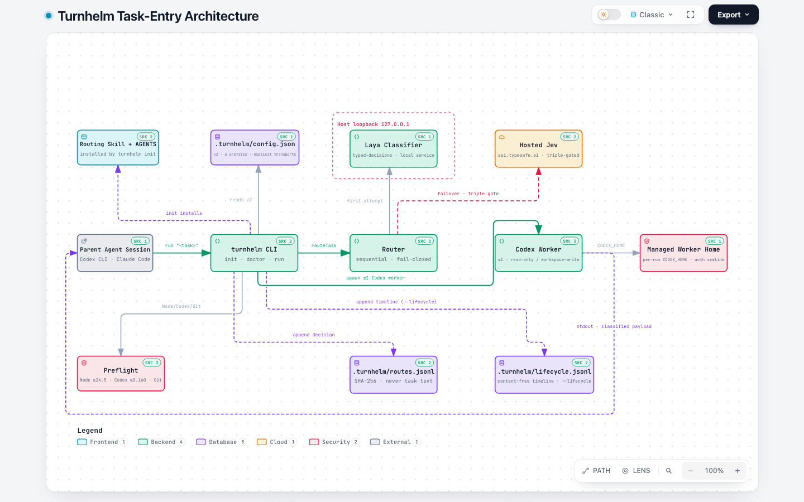
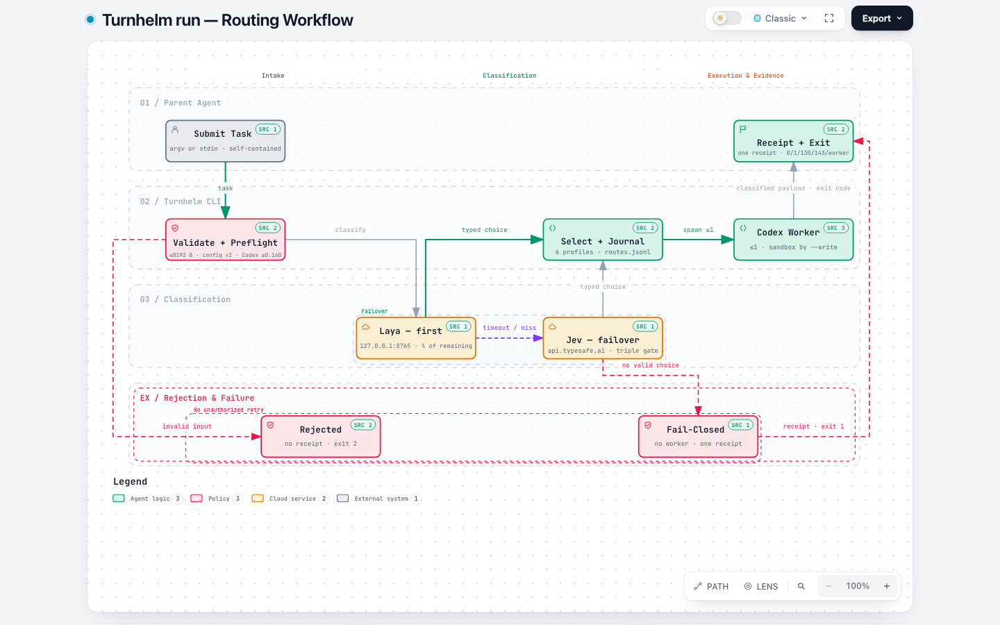

# turnhelm

Local-first task entry for Codex. Turnhelm classifies a coding task against
six fixed model/reasoning-effort profiles, then starts a separate Codex
process with an explicit sandbox boundary.

Turnhelm does **not** switch the model or permissions of the current Codex or
Claude Code session. It is a parent-agent launcher: read-only by default,
workspace writes only with an explicit `--write` command. Codex remains
responsible for its own authentication and provider access.

## Commands

| Command | Behavior | Child sandbox |
| --- | --- | --- |
| `turnhelm init [--dry-run]` | Install the managed skill, project config, and AGENTS block | No Codex child |
| `turnhelm doctor [--json] [--probe]` | Report project, toolchain, config, and skill readiness | No Codex child |
| `turnhelm run [--write] [--output-schema <file>] [--lifecycle] [--] ["<task>"]` | Route the complete task, then start at most one Codex child | `read-only`; `workspace-write` only with `--write` |

All three commands accept `--project <dir>` (relative to the current directory
or absolute). Without it, the current directory is the project root; Turnhelm
does not search parent directories for config or instructions.

The task comes from one self-contained positional argument **or** stdin, not
both (valid UTF-8, at most 8192 bytes; never truncated). Blank, NUL-containing,
continuation-only and invalid/oversized input is rejected. Use `--` before a
task starting with `--`; put all command options before the delimiter. The
router and child do not inherit your current session's conversation.

## Quick start

Requirements: Node.js `>=24.5.0` (Node 24.0 support has been dropped; the CLI
refuses older runtimes before any work; validation runs on an actual
`24.x >=24.5.0`), pnpm `10.12.1` (pinned in `package.json`), a local Git work
tree, and a Codex CLI 0.160.0 or newer.

```bash
# From the Turnhelm source checkout:
pnpm install --frozen-lockfile --ignore-scripts
pnpm run build
TURNHELM_CLI="$PWD/dist/src/cli.js"
turnhelm() { node "$TURNHELM_CLI" "$@"; }

# Replace this with your target Git work tree (not the Turnhelm checkout).
PROJECT=/absolute/path/to/your/project
turnhelm init --project "$PROJECT" --dry-run
# Obtain approval for the reported installation writes before applying them.
turnhelm init --project "$PROJECT"

# Offline readiness: may run local version/help checks, never inference.
turnhelm doctor --project "$PROJECT"
```

The shell function is local to this shell: building does not install a global
`turnhelm` command. You can also call `node "$TURNHELM_CLI" <command>` directly.
Restart existing Codex sessions after initialization to load the instructions.

`init --dry-run` reports planned paths without writing. Repeating `init` is a
no-op when already installed; valid existing project config and unrelated
AGENTS content are preserved. Invalid config, changed owned skill files, or
conflicting managed markers are refused, not overwritten. Inspect and resolve
conflicts yourself; if installation stops early, review its retained files.

The canonical project config template is
[assets/config.json](assets/config.json); `turnhelm init` installs it as
`.turnhelm/config.json`.

Before running a task, configure an eligible classifier and ensure it is
available. The default uses local Laya at `http://127.0.0.1:8765`; Turnhelm does
not install or start it. After approval to send the task to that backend:

```bash
turnhelm run --project "$PROJECT" "Explain this project's entry points without editing files."
# Alternative input (one complete task, not session shorthand):
printf '%s' "Explain this project's entry points without editing files." | turnhelm run --project "$PROJECT"
```

Use `turnhelm run --project "$PROJECT" --write "<complete task>"` only for an
explicitly approved edit. Requesting Turnhelm does not itself authorize writes
or hosted inference. `doctor --probe` is a separate explicit inference opt-in:
it sends one synthetic classification request per eligible backend, up to two;
plain `doctor` never contacts either classifier. Backend eligibility is not
evidence of successful routing or access to the selected Codex model.

## Start an existing local Laya

Reuse an already healthy service; do not start a duplicate. If none is running
and startup is authorized, this foreground reference is for an **already
installed** Laya 0.4.8 serve-capable virtual environment with cached
`typed-decisions` weights:

```bash
LAYA_PYTHON=/absolute/path/to/laya-venv/bin/python
HF_HUB_OFFLINE=1 TRANSFORMERS_OFFLINE=1 \
LAYA_HOST=127.0.0.1 LAYA_PORT=8765 \
LAYA_MODELS=typed-decisions LAYA_PRELOAD=1 \
LAYA_DEVICE=cpu LAYA_THREADS=4 \
"$LAYA_PYTHON" -I -B -u -m laya.serve
```

`4` is an example thread cap; keep it within the machine's physical cores.
The module entry avoids stale console-script shebangs after venv relocation.
Missing serve dependencies or cached weights mean stop and obtain approval
before installation/download. The offline flags constrain Hugging Face model
loading, not every possible network action.

Check from another terminal (no classification or Codex worker):

```bash
curl --fail --silent --show-error --max-time 5 http://127.0.0.1:8765/health
```

Expect `status: "ok"` and `typed-decisions` in `loaded`; inspect the reported
checkpoint device. This foreground example does not install a supervisor or enable
login/reboot autostart. Health alone does not prove a real task can be
classified within the routing deadline.

## Project configuration

`.turnhelm/config.json` (version 2) is Turnhelm's only configuration file. There
is no global or home-directory Turnhelm config; Codex manages its own settings
and authentication separately. Unknown project config keys are rejected.

```json
{
  "version": 2,
  "routingTimeoutMs": 10000,
  "backends": {
    "laya": { "enabled": true, "url": "http://127.0.0.1:8765" },
    "jev": { "enabled": false, "transport": { "mode": "direct" } }
  },
  "profiles": {
    "fast": { "model": "gpt-6-luna", "effort": "low" },
    "balanced": { "model": "gpt-6.1-sol", "effort": "medium" },
    "deep": { "model": "gpt-6.1-sol", "effort": "high" },
    "frontier": { "model": "gpt-6-astra", "effort": "high" },
    "frontier_xhigh": { "model": "gpt-6-astra", "effort": "xhigh" },
    "frontier_max": { "model": "gpt-6-astra", "effort": "max" }
  }
}
```

- `routingTimeoutMs` is the total classification budget, an integer from 100
  to 30000; the current template uses 10000ms, not a latency guarantee.
- `backends.laya.url` must be an HTTP loopback origin without credentials,
  path, query, or fragment.
- `backends.jev.transport` is required whether Jev is enabled or not, and is
  exactly `{ "mode": "direct" }` or
  `{ "mode": "http-connect", "proxyUrl": "http://127.0.0.1:7890" }`. A
  `proxyUrl` must be the literal `http://127.0.0.1:<port>` or
  `http://[::1]:<port>` — an explicit decimal port from 1 to 65535 without
  leading zeroes, at most one trailing slash, at most 256 characters, and no
  userinfo, path, query, fragment, whitespace, or percent encoding. That proxy
  example shows configuration shape, not execution authority or permission to
  edit an existing project's config. Transport policy is never taken from the
  environment (`HTTPS_PROXY`, `HTTP_PROXY`, `NO_PROXY`, and case variants are
  ignored); a missing or malformed transport is a config failure, never an
  implicit direct connection.
- Version 1 configs (a `jev` entry without `transport`) and any other invalid
  config are refused by `run` and `doctor --probe` before classification, and
  reported as a config failure by offline `doctor`. Nothing is migrated,
  rewritten, or deleted automatically: the owner reviews and replaces the file
  with a version-2 config, or removes it and re-runs `turnhelm init` (unrelated
  files are preserved). A valid existing version-2 config is preserved and
  repeated `init` stays a no-op.
- All six profiles are required; each names a model and reasoning effort.

## Six profiles and automatic selection

Successful classification selects one of the six profiles; there is no bypass,
no max-effort flag, and no extra classification stage. `frontier_max` is an
ordinary selection outcome reached when the task genuinely needs maximum
effort.

Selection is judged by uncertainty, coupled constraints, required
verification, and the consequences of an incorrect result — never by prompt
length or keywords. The config above gives the template defaults, not a model-access
guarantee; project config supplies the actual model/effort pairs.

## Classification request and response

The task text is sent to the configured backend at `POST /v1/systemone`:

```json
{
  "state": "<task>",
  "model": "typed-decisions",
  "max_len": 8192,
  "questions": {
    "route": {
      "type": "choice",
      "instructions": "Choose the lightest profile that meets the task's requirements, judged by uncertainty, coupled constraints, required verification, and the consequences of an incorrect result; never by prompt length, file count, or keywords such as security, architecture, or deep analysis.",
      "criteria": { "fast": "...", "balanced": "...", "deep": "...", "frontier": "...", "frontier_xhigh": "...", "frontier_max": "..." }
    }
  }
}
```

These criteria strings are v1 and current: a criteria-v2 policy-alignment
experiment (2026-10-12) found no revision that satisfied its adoption gates
and shipped nothing; the sealed record, including the best rejected draft,
is `docs/validation/2026-10-12-calibration-v2.md`.

Laya's `max_len` is a token window, distinct from the 8192-byte task limit.
Hosted Jev uses the same envelope with `model: "jev-latest"` and no `max_len`.
The required response shape is the nested choice answer:

```json
{ "answers": { "route": { "type": "choice", "choice": "<profileId>" } } }
```

`choice` must be one of the six own profile IDs; anything else fails that
backend attempt, with only the budgeted, authorized failover below available.
The reply may also carry `confidence`, a number in `[0, 1]`; Turnhelm validates
that range, records the value in the route journal, and never uses it to gate
selection.
When Laya returns `usage`, it must report `truncated: false` and
`state_tokens_dropped: 0`; otherwise that attempt fails. Absent usage does not
prove the classifier consumed the full task.

## Backend failover

Routing is sequential, not parallel. Local Laya is tried first when
`backends.laya.enabled` is true; a successful Laya choice means no Jev request.
When **both** backends are eligible, Laya receives `floor(remainingBudgetMs * 3 / 4)`:
approximately 7500ms of the default 10000ms total budget, reserving the other
quarter for authorized Jev failover. This avoids a fixed one-second cutoff for
CPU inference. Jev receives only the time left on the shared deadline; an early
Laya failure leaves it more time, while scheduling delays can leave it less.
A sole eligible backend receives the total remaining budget. These allocations
are engineering limits, not latency guarantees.

Each backend rides one explicit transport from the frozen config. Laya is
always direct HTTP to its configured loopback origin and never transits the
proxy. Jev uses
`backends.jev.transport`: direct HTTPS to the fixed origin
`https://api.typesafe.ai/v1/systemone`, or `http-connect`, where the configured
loopback proxy receives only a CONNECT to `api.typesafe.ai:443` — the
authorization header and request body travel inside TLS after certificate and
hostname verification, never in CONNECT headers. Each request uses one scoped
agent with keep-alive off; every outcome — success, failure, size cap, or
abort — destroys the request, its response, its sockets (including a CONNECT
tunnel still pending), and the agent exactly once. A transport failure (407,
dead port, disconnect, timeout, TLS rejection) fails that attempt closed: no
retry, redirect following, or fallback to a direct connection, and no
environment or system proxy is consulted. The transport recorded in evidence
is application policy — what Turnhelm was configured to dial, not proof of the
proxy's actual exit node, route, or receipt.

Hosted Jev is attempted only
when **all** of the following hold: `backends.jev.enabled` is true in the
project config, `TURNHELM_ALLOW_HOSTED_JEV=1` is present in the environment,
and `TYPESAFE_API_KEY` is nonblank. The config and environment gates require
deliberate authorization for hosted inference; Turnhelm never enables them
automatically. Supplying a key alone does not opt in.

If no eligible backend returns a valid choice within the budget, routing fails
closed: no Codex child, heuristic fallback, or bypass. Backend failover stays
within the configured gates; classifier or model-access failure never triggers
an unapproved model retry. Local Laya may require `LAYA_API_KEY`.

## Route decision journal

Every `run` that reaches classification appends one JSON line to
`.turnhelm/routes.jsonl` in the project root before the worker starts,
regardless of whether routing selected, failed, or was cancelled. Each line
records the timestamp, the task's SHA-256 hash and byte length (never the task
text), the routing status, attempts with per-backend transport mode (`direct`
or `http-connect`), outcomes, and durations, and, for a selection, the backend,
profile, model, effort, and the classifier's
`confidence` when the backend reports one. The journal is evidence for
reviewing routing decisions; it is written best-effort — an append failure is
reported on stderr and never fails the run. A journal path that is not a
regular file (for example a symlink or a FIFO) is refused and skipped rather
than opened.

## Safety boundaries

- **Read-only by default.** The Codex child receives `--sandbox read-only`
  unless `--write` was given explicitly on the same `run` invocation.
  `--write` does not override host sandbox restrictions on protected paths.
  `--sandbox read-only` denies writes, not reads: read-only mode itself does
  not prohibit reading, though whether any specific file is readable still
  depends on host permissions. The 2026-10-17 validation campaign observed a
  worker claim it could not read a file in a read-only run; the internal
  cause of that refusal is unresolved.
- **No recursion.** Turnhelm marks its Codex children with
  `TURNHELM_MANAGED_CHILD=1`; `run` inside such a session is refused.
- **Initial process environment only.** `LAYA_API_KEY`,
  `TYPESAFE_API_KEY`, `TURNHELM_ALLOW_HOSTED_JEV`, `TURNHELM_CONFIG`, and
  the startup-file keys `BASH_ENV` and `ENV` are removed from the
  environment passed when spawning the Codex worker — a non-interactive
  bash or POSIX-shell descendant would otherwise source them at startup and
  re-import stripped material, the same route zsh's startup files used —
  and the run redirects `HOME`, `ZDOTDIR`, and `CODEX_HOME` to the run's
  managed per-run home, so a worker shell or descendant that resolves
  startup files, agent-skill directories, or dotfiles through `$HOME` finds
  the run's empty managed home instead of the host's (a write-mode task
  that must create commits now needs the identity stated in the task;
  registry-authenticated installs inside a worker must arrive through the
  task's own inputs). The child's environment also drops a frozen list of
  host data/config/credential discovery and action-capable pointers —
  `AWS_CONFIG_FILE`, `AWS_SHARED_CREDENTIALS_FILE`,
  `AWS_WEB_IDENTITY_TOKEN_FILE`, `DOCKER_CERT_PATH`, `DOCKER_CONFIG`,
  `DOCKER_CONTEXT`, `DOCKER_HOST`, `GIT_CONFIG`, `GIT_CONFIG_GLOBAL`,
  `GIT_CONFIG_SYSTEM`, `KUBECONFIG`, `NPM_CONFIG_GLOBALCONFIG`,
  `NPM_CONFIG_USERCONFIG`, `SSH_AUTH_SOCK`, and the `XDG_*` home/dir
  pointers (`XDG_CACHE_HOME`, `XDG_CONFIG_DIRS`, `XDG_CONFIG_HOME`,
  `XDG_DATA_DIRS`, `XDG_DATA_HOME`, `XDG_RUNTIME_DIR`, `XDG_STATE_HOME`);
  the two npm keys match case-insensitively, every other key exactly;
  executed-worker receipts carry `envBoundary: "host-pointers-v1"` — the
  generation tag of this scrub, so a list change is a new tag, never a
  silent edit. Consequence class: host configuration reachable only through
  a listed pointer must arrive through the task's own inputs. This is still
  not host filesystem secret isolation:
  unlisted environment pointers (for example `AWS_CA_BUNDLE`),
  system-level startup files outside any home,
  absolute reads of host files, or a key already exported by another
  mechanism remain outside this boundary. Keep secrets out of tasks, logs,
  diffs and config; do not read key values or change host
  authentication/startup files to make a check pass.
- **Worker instruction boundary.** Every run creates a fresh per-run
  `CODEX_HOME` (a `mkdtemp` directory under the system temp dir) and passes
  `--ignore-user-config --ignore-rules --ephemeral`, which suppress the ambient
  codex channels rooted in `CODEX_HOME` and the user profile (`config.toml`,
  `-p` profiles, `.rules` files, the home's `AGENTS.md`, hooks and persisted
  hook trust, MCP servers, sessions). The remaining instruction surface is the
  task, the cwd project tree, and Turnhelm's explicit argv — plus one fixed
  sandbox-semantics note (version tag `sandbox-semantics-v1`) the runner
  appends after the task on the worker's stdin; the classifier and the routes
  journal still see the bare consumer task, and executed-worker receipts carry
  `instructionNote: "sandbox-semantics-v1"` as a mechanism attestation, not a
  claim the worker obeyed the note. The managed home
  is initialized with only the staged output schema (when one was given) and,
  when a credential source exists, a symlink to the parent's `auth.json` — the
  native codex runtime may add its own scratch there; the link is reached by
  symlink, never copied or logged; a
  `CODEX_HOME` value inherited from the environment is never forwarded as the
  worker's home. A run with no discoverable credential (no `auth.json` at the
  parent-derived source and no exported `OPENAI_API_KEY`) is refused before
  classification. Executed-worker receipts carry `codexHomeManaged: true` — a
  mechanism attestation that this machinery ran, not an isolation claim. The
  enforced set is scoped to HOME-derived and listed-pointer discovery:
  unlisted environment pointers such as `AWS_CA_BUNDLE`, system-level
  startup files outside any home, managed/admin hook layers outside
  `CODEX_HOME`, a project `AGENTS.override.md`, and absolute reads of host
  files by an authorized worker remain residuals outside this boundary,
  stated as residuals —
  hermetic `HOME` closes default discovery paths, not the host filesystem boundary.
  The home is destroyed after settlement
  discharge on every path; a boundary-machinery failure fails closed (the run
  is refused) rather than running with an inherited home.
- **Opt-in output schema.** `run --output-schema <file>` passes a JSON Schema
  to the worker so its final message is checked against your schema by Codex
  itself. The file is validated exactly once at the input boundary — a
  readable regular file (symlinks refused), at most 65536 bytes, strict
  UTF-8, a single JSON object — and the validated bytes are staged inside the
  managed home; the caller's path is never forwarded or re-read, so later
  mutation of the file cannot change what the worker saw. The receipt's
  `payload.mode` still reports framing only; schema conformance is the
  consumer's acceptance gate.
- **Opt-in lifecycle evidence.** `run --lifecycle` records a bounded,
  content-free worker timeline: a frozen event taxonomy (spawned through
  settle) with millisecond ages, never worker output, task text, or error
  prose. The executed-worker receipt carries a `lifecycle` projection of at
  most 64 events (first 8 and last 56 kept, with an `overflow` marker), and
  each event is also appended best-effort to `.turnhelm/lifecycle.jsonl` under
  the project root — the journal outlives a hard kill that prevents the
  receipt. A journaling failure never fails the run; fire-and-forget appends
  may briefly hold the event loop at exit. Decoded
  `item.started`, `item.updated`, and `item.completed`
  frames from non-agent items join the timeline as activity events carrying
  fixed metadata only — `itemKind/itemPhase/itemStatus/itemExitCode`, where
  `itemKind` is `reasoning`, `command_execution`, or `file_change` with any
  other native type collapsing to `other`; `itemExitCode` is
  legal only on completed command executions — and
  the command text is never retained anywhere. Agent messages surface only at
  completion, and in-flight agent frames are ignored. A completed item
  reports one fixed diagnostic line, `turnhelm: worker-activity`, on stderr;
  started and updated items report none.
- **Opt-in stall abort.** `run --stall-abort-ms <ms>` (integer 5000–3600000)
  arms a stall watchdog inside the run: once at least one frame has decoded,
  no terminal event has arrived, and no further frame decodes for the given
  span, the runner records one `stall-abort` lifecycle event and drives the
  existing owned TERM→KILL shutdown ladder unchanged. The run settles as a
  cancelled run does and the receipt adds `abortReason: "stall"` beside the
  existing `ownedShutdown`/`progressEvents`/`lastEventAgeMs` observations;
  the CLI exit follows the ordinary worker-exit rules (typically 143, or 137
  after the grace), with no stall-specific normalization. A run with zero
  decoded frames never stall-aborts — absent evidence is unknown, and a
  silent-from-birth worker stays under the ordinary deadline. It is a
  parent-observed action record, never a liveness or causation claim.
- **Completion is not verification.** A `completed` worker (exit 0) proves the
  child finished its turn — nothing more. Whether the task was actually done
  is judged by consumer-side gates: the output schema above, oracle and
  contract checks, review of the diff and tests. Never treat native
  completion as task verification. Observed worker failure modes
  (2026-10-17 campaign, every one caught by consumer-side gates): a wrong
  refusal, claimed completion with the implementation unchanged, and
  schema-valid but value-wrong output — native completion and schema framing
  never establish semantic correctness.
- **Bounded child output.** Raw worker stderr and arbitrary error text never
  cross the diagnostic boundary; the parent prints fixed-category lines and
  the structured receipt on stderr. A failed worker turn reports exactly one
  fixed line, `turnhelm: worker-failed: <class>`, where the class comes from
  a frozen taxonomy (`stream-disconnected`, `rate-limit`, `usage-limit`,
  `timeout`, `auth`, `overloaded`, `unknown`) matched against the native
  message — the message itself never crosses; only its SHA-256 does, in the
  receipt. Stdout carries at most one worker message — the final agent
  message, written once when the run completes; earlier messages are
  decoded, counted, and discarded. At emission the message is classified:
  one JSON value is emitted verbatim (`payload.mode: "strict"`); a payload
  line plus inert trailing prose yields exactly the payload line
  (`"extracted"`, with `trailerBytes` in the receipt — the dropped trailer
  is retained nowhere); further structured content after the payload line,
  or any non-JSON message, is emitted verbatim (`"conflict"` /
  `"unstructured"`); every emission is the classifier's text plus one
  appended newline. The boundary is a delimitor, not a validator — payload
  contents are not checked — and stdout is still not a general-purpose
  redactor for secrets in that message. A failed or cancelled run initiates
  no write (delivery is not transactional: a cancellation landing mid-write
  may leave bytes, so gate on the exit code and receipt, never on stdout
  presence). The final message is arbitrary content — not guaranteed JSON.
- Remove secrets and sensitive data from a task before routing; the full
  task text is sent to the configured classifier.
- **Cancellation.** `run` and `doctor` handle SIGINT/SIGTERM, abort owned work,
  and stop their owned subprocess groups (exit 130/143). Before classification,
  cancellation or task/config/preflight rejection emits no run receipt. Once
  classification starts, `run` emits exactly one JSON receipt on stderr at the
  end, including routing failure/cancellation and the worker outcome.
  Client cancellation does not prove backend inference has stopped.

The receipt's `worker` object always carries the status, duration, usage,
and, once a worker actually executed, the exit code and `ownedShutdown` —
a required boolean action record meaning a parent-initiated stop ladder
ran, never a causation claim. A clean run settles at the decoded
`turn.completed` event: the payload write is accepted first, then the
owned ladder bounds teardown (SIGTERM at once, SIGKILL after one second),
so `ownedShutdown` is true on completed runs too, and the exit code after
a completed turn is an observation of how the group ended — never a
completion signal. A run
that never started a worker reports exactly
`{ status: "not-started", durationMs: 0, progressEvents: 0, usage: "unreported" }`
with no exit-code or action fields. A failed worker also carries the frozen
`failureClass` (plus `errorSha256`, a SHA-256 over the native error bytes
for cross-run correlation, when a native message existed); a worker that
died by SIGINT/SIGTERM/SIGKILL — failed or cancelled — carries the death
`signal`. Every worker receipt also carries `progressEvents` — the count of
event frames the parent successfully decoded, malformed frames excluded —
and, once at least one decoded, `lastEventAgeMs`, the rounded milliseconds
from that last decode to settlement. Both are parent-observed,
backpressure-bounded observations, never liveness or stall claims. The text
behind that hash never crosses the diagnostic boundary.

## Usage evidence is honest, not authoritative

- When the Codex child reports no usage snapshot, the receipt says
  `usage: "unreported"` — never zero and never omitted.
- `classifierUsage` is `"unreported"` unless a Laya selection carries its
  bounded projection of exactly `input_tokens`/`state_tokens` (Laya's field
  names, non-negative safe integers) — evidence that never gates an outcome;
  hosted Jev never projects. `wholeRunUsageScope` is
  `"unverified"`: receipts report worker snapshots, not a whole-run token
  total, bill or saving percentage. The recorded real runs used ChatGPT
  login; that is not evidence of API-key metered charges.
- Codex client config-key semantics (for example `agents.enabled`) are
  **unverified** from `--help` evidence alone; doctor reports this
  explicitly instead of claiming a pass.

## Validate routing with the actual requirement

On the intended branch, submit the complete real task once; do not force a
profile or add a preliminary worker merely to test routing. Put the complete
requirement and execution boundaries in a UTF-8 file, not an abbreviated smoke
prompt (the same 8192-byte limit applies):

```bash
TASK_FILE=/absolute/path/to/complete-task.txt
# Obtain explicit write authorization immediately before this invocation.
turnhelm run --project "$PROJECT" --write < "$TASK_FILE"
```

Read the exit code and the receipt's `routing`, `selection`, and `worker`
statuses, then review the scoped diff and tests. A selected model is not
acceptance of its output. If no valid choice is obtained within the total
routing budget, no worker starts; a single Laya timeout can still be followed
by an authorized Jev success. Report routing/worker failure instead of silently
increasing the budget or retrying a different model/backend.

To exercise both eligible classifiers, obtain separate request/hosted consent
before `turnhelm doctor --probe --json --project "$PROJECT"`. It sends one
synthetic request per eligible backend but no worker, through the same shared
request boundary, eligibility gates, and explicit Jev transport policy as
`run` — the probe has no separate network path. A failed probe's evidence
line carries the last observed HTTP status with the same fixed guidance
wording, never a raw response body. Both probe results plus
one successful real task prove only those observed paths, not general quality,
all six model/effort combinations, whole-task cost, or savings.

These checks have different execution and authorization scopes:

| Check | Classifier requests | Worker invocations |
| --- | --- | --- |
| Plain `doctor` | None; offline version/help/config checks | None |
| `doctor --probe` | One synthetic request per eligible backend, at most two | None |
| Normal `run` | Full real task; at most one attempt per eligible backend, sequentially | At most one, after selection |
| `pnpm run test:live` | Reserved per suite and never exceeded: `laya` ≤ 7, `jev` ≤ 1, `dual` ≤ 2 per backend, `calibration-dev`/`calibration-holdout` ≤ 12 each with no Jev | Reserved per suite: `laya` ≤ 7, `jev` ≤ 1, `dual` ≤ 2; the calibration suites reserve 0 workers |

`test:live` is a two-step, separately authorized acceptance run, not part of
the offline suite. `node dist/test/live.integration.js --prepare laya|jev|dual|calibration-dev|calibration-holdout`
is fully offline and spends nothing: it freezes a private run root, writes
`manifest.json` (per-case roots, identities, task hashes, configs, oracle
facts, and reservation caps), and prints the manifest path plus its sha256. A
human reads the complete manifest and explicitly approves that sha256;
`--execute <manifest.json> --approve <sha256>` then runs. `--prepare` also
accepts `--config <file>`, an owner-reviewed version-2 config read once —
regular file, at most 65536 bytes, strict UTF-8 and JSON — and frozen into the
manifest; execution never rereads the external file, and any read or
validation refusal happens before a run root exists and prints one fixed
content-free diagnostic. With the `dual` suite only, `--case dual-jev-write`
narrows the roster to the existing Jev write fallback case; unknown, duplicate,
or missing prepare flags are refused, and prepare options are not accepted on
`--execute`. The two reachable specialized forms are:

```sh
node dist/test/live.integration.js --prepare jev --config ./acceptance-config.json
node dist/test/live.integration.js --prepare dual --config ./acceptance-config.json --case dual-jev-write
```

These are future offline preparation examples, not commands to run now and not
authorization to supply credentials or prepare real consumer roots. Each
creates a separate singleton manifest with its own fresh sha256 and
reservations — the `jev` form caps `{worker:1, laya:0, jev:1}`, the
`dual --case` form `{worker:1, laya:1, jev:1}` — and each is read and approved
separately. The pair is gated manually: execute the readonly Jev case first
and reconcile its exit code, complete records, and transport evidence
yourself; only an explicit owner approval opens the write case, and any first
failure or incompleteness closes it. No extra probe, worker, retry, or
deadline extension runs between them. Two successful cases would remain two
observed executions: they would not resolve the open band-policy, optimality,
or billing findings. Each manifest is one
suite only; reservations never carry across suites. The manifest claims
exactly once (a second execute refuses), so a run is never replayed or
resumed; drift in the baseline, corpus, or any frozen case file stops it
before further spend. Output judging is adjudicated for stdout only: a
stdout case passes when the whole stdout is the exact contract JSON object,
or that object on line 1 followed solely by inert trailer lines — lines
that parse as no JSON value, open with no object/array/string, and are no
code-fence delimiter, so a second structured payload cannot ride along.
The summary-file oracle stays strict: the payload must be the entire file.
Each case reserves its caps to the append-only evidence
journal (mode 0600) before any call; the journal stores bounded fixed fields —
never task text or environment values — and unknown receipt data degrades to
fixed `invalid`/`unknown` markers, with one deliberate exception: each judged
case retains its `oracleInput`, the exact stdout or summary bytes the oracle
judged, bounded to 64 KiB of UTF-8 before serialization. That is deliberate
raw-content retention, not secret sanitization: it is private to the claimed
run and covered by the manifest approval, and never a license to put secrets
in task output. Observed records also carry `workerUsage`, a whitelisted
four-counter projection whose scope is unverified, and `workerFailure` —
the frozen failure class plus the `ownedShutdown` action boolean, with an
optional correlation hash and observed death signal; no failure text —
plus `workerProgress`, the receipt's decoded-event count and, when one
decoded, the last decode's age at settlement, the same parent-observed
projection that never claims liveness. Every attributable outcome also
carries `workerLifecycle` — the bounded content-free worker timeline (`tMs`
and `kind`, plus at most a fixed-vocabulary `detail`: process and settlement
facts, or a decoded activity item's `itemKind/itemPhase/itemStatus/itemExitCode`
where `itemExitCode` is legal only on completed command executions; at most
64 events, first 8 and last 56 kept) projected from the receipt's `lifecycle`
field, or rebuilt from the best-effort `.turnhelm/lifecycle.jsonl` journal
(a 1 MiB cap) by the supervised CLI's pid when the receipt carries none —
an executed worker retains its timeline on every attributable outcome,
pass and wrong answer included, while a projection or journal fault
degrades to absent evidence and a not-started worker never gains a timeline.
Observed and case records also carry
`attemptTransports`, a bounded projection of the per-attempt backend and
transport mode — at most two entries in a Laya-then-Jev subsequence with Laya
always direct; missing, duplicate, reversed, oversized, or otherwise invalid
data reads `unverified`, with nothing fabricated. It records the frozen
application policy, never a proxy exit, route, or receipt attestation, and it
never gates an ordinary case: only the `jev-default-readonly` and
`dual-jev-write` cases add a `transport-policy` check that their observed
attempts match the frozen config, and a mismatch fails that case through the
ordinary verdict path. The harness also exports its shared
oracle primitives — the payload-agnostic `envelopePayload` envelope fact
and the root-parameterized `oracleSandboxPolicy` sandbox profile — so
sealed-round tooling and tests judge against one frozen definition instead
of two that drift. Each worker-suite case freezes its own integer `deadlineMs`
(5000–3600000 ms) at prepare and may carry its own output schema through the
same CLI flag; an expired deadline is an unjudged `timeout` verdict behind
custom-round's three gates — the CLI must close cleanly, carry exactly one
CLI receipt (a receiptless timeout, a killed CLI, stops the round with its
crash evidence retained), and leave a settled tree — never a stop by itself.
Exit codes: `2`
usage, `1` failure or incomplete, `0` complete pass, `3` a complete
calibration roster containing a band-policy mismatch, `4` a complete worker
roster containing at least one failed or timed-out case, `130`/`143` on
interrupt. In the calibration suites a legal-but-out-of-band selection is
recorded as a policy mismatch and the roster continues to its full 12 calls;
in worker suites a task-output failure — wrong or missing output with every
integrity check true — fails that case and the approved roster continues, as
does an unjudged per-case timeout. Only those classes continue:
every other failure, including any integrity failure (a mid-case replacement
of the consumer root is caught by the `root-identity` check), stops the round
immediately. A visible `completed` journal record plus its exit code is a
convenience status only: acceptance reconciles unique case IDs, per-case
verdicts, the completed counts, the absence of a terminal `stopped` record,
and the actual process exit before signing anything — a failed terminal sync,
close, or drift recheck after the `completed` record still fails the run. The
2026-10-12 routing-validation findings remain open until a fresh acceptance
run passes them; nothing here claims their resolution.
Cancellation signals only the owned CLI child (SIGINT, then SIGTERM after a
fixed grace); descendants it leaves behind are not scanned or killed, and a
child that still does not close stops the round as `cleanup-unverified` rather
than hanging. Do not use `test:live`, help/health, or a short `1+1` smoke prompt
as acceptance of the actual documentation or implementation task. Receipt
request counts are client attempts, not proof of server receipt or billed
requests; worker-activity lines are not a count of the worker's internal tool
calls. The timeline carries
no tool-call count, no exact file reads, and no causal ordering — equal
timestamps carry no order claim — and absence or
overflow of activity events is unknown evidence, not zero actions.

## Agent skills (Codex CLI + Claude Code)

The canonical shared skill is
`.agents/skills/turnhelm-routing/SKILL.md`; `turnhelm init` installs it into
the project and the package includes that same file. In this source checkout,
`.claude/skills/turnhelm-routing` is a symlink to the shared directory; preserve
it, not a separate Claude copy. `init` refuses differing installed skill bytes,
so updating the source template does not silently migrate existing consumers.
Codex CLI and Claude Code use the same instructions:
one self-contained prompt, read-only default, explicit `--write`, automatic
`frontier_max` selection, and no unapproved model retry after failure.

## Development and verification

```bash
pnpm install --frozen-lockfile --ignore-scripts
pnpm run build

# Hermetic tests: do not use classifier credentials or hosted Jev.
env -u TYPESAFE_API_KEY -u LAYA_API_KEY -u TURNHELM_ALLOW_HOSTED_JEV pnpm test
env -u TYPESAFE_API_KEY -u LAYA_API_KEY -u TURNHELM_ALLOW_HOSTED_JEV pnpm run test:coverage
# Coverage-claim rule: admission suites rebind profile mappings per tuple, so
# admission is evidence of execution under a forced pair, never of natural
# selection; any six-profile natural-coverage claim requires natural runs with
# unchanged mappings, reported with actual selections and remaining gaps.

# Dependency audit.
pnpm audit --audit-level high
```

The checkout also carries a hermetic custom-round runner — `test/custom-round.ts`,
exported through the built `dist/test` surface and invocable as
`node dist/test/custom-round.js prepare <roster.json>` / `execute <manifest.json>
<sha256>` — for owner-defined validation rosters. The round input is a
data-only JSON roster: nothing executable is trusted from it, and every
referenced file is hashed into a frozen manifest as data, alongside a per-case
snapshot of the whole consumer tree. Each roster case carries a required
integer `deadlineMs` (5000–3600000 ms) that the runner supervises the case CLI
under, may carry an `outputSchema` file frozen with the same hash record, and
may carry an optional `stallAbortMs` (same integer window) the runner passes
through as `--stall-abort-ms`; a lone attributable receipt whose worker
carries `abortReason: "stall"` settles as the unjudged `timeout` outcome at
the same decision position as an expired deadline — no oracle, no contract
check, the roster continues — while a stall receipt that is not lone or not
attributable follows the existing stop rules. `prepareRound` validates the roster,
re-verifies the pinned HEAD and the whole-consumption baseline (every built
module the round executes), preflights the sandbox machinery and each roster
contract's loadability, and writes the manifest with a human approval request
while spending nothing — zero classifier requests and zero worker executions,
asserted by the manifest's zero-spend block. `executeRound` runs only under
the human-approved sha256: it re-verifies manifest bytes, evidence-root
identity, runtime, HEAD, and baseline, claims the append-only evidence ledger
exactly once (a replay refuses), and gates every case identity-before-spend —
root dev/ino identity, frozen file hashes, the frozen tree, and the consumed
baseline re-verify before each reservation, and a reserved record that cannot
be written stops all remaining spend. A run must carry exactly one CLI receipt
to be graded; journal backend/profileId values surface only through a fixed
whitelist; a legal profile outside the case's allowedProfiles fails its case;
and each judged case retains its bounded `oracleInput`. After the worker runs,
a fixed decision order holds: abort; unverified cleanup (a possibly-live CLI,
stop `cleanup-unverified`); output cap (stop `output-cap` — overflow also
raises the timeout flag, which is why it is decided first); exactly one CLI
receipt (anything else stops `receipt`); auth-, rate-limit-, and
usage-limit-class receipts (stop `worker-<class>`); timeout; then grading.
Every case then passes the same settled-tree gate — root dev/ino plus
canonical-path re-check and a re-hash against the case's allowedChanges —
graded or timed out: a same-content root replacement stops `root-identity`,
and a write outside the allowance stops `tree-drift`, even when the output
graded fine. The same identity rule binds the frozen inputs: every
roster-referenced file — including a case's `outputSchema` — re-verifies
dev/ino plus bytes at the pre-spend gate, and the oracle's consumed inputs
(contract, task file, hooks) re-verify again around the sandboxed contract
check, so a byte-identical rebind of an oracle or contract
file stops `oracle-identity` before any spend, while a mutated or missing
file stops `case-files`. A timeout is an unjudged per-case outcome, not a stop
(`outcome:"timeout"`): no oracle grading and no contract check, and after the
settled-tree gate its case record is appended and the roster continues to the
next reservation. Every case record (pass, failed, or timeout) and the
post-CLI stop records (`cleanup-unverified`, `output-cap`, `worker-<class>`,
`tree-drift`, `root-identity`, the pre-/post-contract `oracle-identity`
stops; not the `receipt` stop, which has no single
receipt to project) carry a `workerFailure` whenever the lone receipt's
worker object is projectable (absent, non-record, or an out-of-enum status
omits the field, never fabricates it): a per-field projection of the
run's single receipt worker object — a frozen status enum plus optional
`code`, `durationMs`, `progressEvents`, `ownedShutdown`, `usage`,
`failureClass`, `errorSha256`, `signal`, and `lastEventAgeMs`, the note tag
`instructionNote` when one nonempty tag string is present, and `abortReason`
only on the stall path. Unselected
receipt keys (such as the worker `payload`) are ignored, malformed fields are
dropped individually and never coerced, and `errorSha256` is correlation-only
— no error text or stderr bytes are retained; zero-valued counters stay as
observations (`progressEvents:0` means zero decoded frames). These are
parent-observed counts and ages and an action record for `ownedShutdown` — no
liveness, stall, or causation claims ride them. The same attributable records
also carry `workerLifecycle` under the same lone-receipt rule for an executed
worker — projected from the receipt, or by the normal-path journal fallback
past the cleanup, output-cap, receipt, and stop-class gates, filtered to the
supervised CLI's pid — while contract-infrastructure, signal, and pre-spend
stops carry none, and a not-started worker never gains a timeline. Both CLI
transports launch with `--lifecycle`, and the settled-tree freeze exempts
the exact regular `.turnhelm/lifecycle.jsonl` leaf from size and hash
accounting (the CLI owns its growth; the reader caps it) — but
symlink, FIFO, or directory at that path still stops the round as drift, and
any other new `.turnhelm` file still drifts. Terminal evidence appends are
load-bearing: a case record the ledger cannot take stops the round
(`stopped {reason:"evidence-io"}`, exit `1`), and after the last case a
`completed` record (`{phase:"completed", outcome:"pass"|"fail", cases, failed,
timedOut}`) reconciles the case records actually written, while a signal
discovered after the last append still settles `130`/`143` rather than a
would-be `0`/`4`. Task-output and contract-assertion failures fail their case
and the roster continues. Exit semantics: `0` complete all-pass; `4` complete
roster with one or more `failed` or `timeout` cases; `1` every stop and
refusal — identity, baseline, or tree drift, receipt count, output cap,
cleanup, check infrastructure, stopping worker receipts, and usage or prepare
refusals — custom-round never exits `2`, and `3` is calibration-only and never
emitted by custom-round; a roster whose planned spend exceeds its frozen caps
is refused before launch; SIGINT anywhere in the round, including
mid-contract, settles gracefully with `130` and SIGTERM with `143`. Campaign
drivers must continue only on `0`, `3`, and `4` and halt on everything else —
`1`, `130`, `143`, and any unexpected code — and a per-case worker CLI exit
of `143` is a graded case outcome inside a manifest, never a campaign-process
`143`. Worker-write contracts execute inside the
runner's sandboxed check launcher, whose runner-owned fd-3 outcome record
replaces exit-code and stdout inference; the launcher drives
`/usr/bin/sandbox-exec` with a generated seatbelt profile (macOS), the
hermetic tests substitute a path-injected fake on every platform, and only
the macOS-gated test exercises the real profile. Two harness pins landed with it: acceptance-style tests
observe actual fake-worker invocations rather than reserved records, and the
worker receipt's `lastEventAgeMs` is pinned positive through a post-drain
settlement gap. Roster authoring rule: an oracle whose verdict depends on
ordering, ties, or direction — sort order, first-match, prefix direction —
must state the direction it judges and include one worked example with tied
inputs, so a mis-graded tie is caught by the roster itself; a task whose
oracle verdict depends on when an effect must happen — a synchronous throw
versus a deferred rejection, a same-turn identity window for promises or
handles, state visible before versus after settlement,
retry-after-settlement semantics — must state the timing policy it judges
and include one worked call-order example exercising the ambiguous boundary
(for a fetch that throws synchronously: whether the immediately following
same-key call must return the identical promise, and whether rejection is
deferred to a microtask), with the task text imposing exactly the policy the
oracle judges; sealed oracles
and recorded grades are never edited after the fact — a defective oracle is
retired and replaced, not rewritten.

The minimum Codex contract remains **0.160.0**. Compatibility evidence includes
0.160.0 (official native binary:
`--version` exit 0, `exec --help` advertising `--json`, `--ephemeral`,
`--sandbox`, and stdin), local 0.160.1, and actual **0.161.0** use in the
post-merge Laya → Codex and hosted Jev → Codex runs. Both returned the same
eight-case coupon oracle correctly with CLI/worker exit 0, naturally selecting
different profiles. These are observed paths, not six-profile access,
classification-quality or billing guarantees. Functional delivery does not
authorize a benefit trial; a fixed-baseline comparison needs separate owner
approval. Detailed, dated evidence and remaining limits are recorded in
[`docs/validation/2026-10-08-turnhelm-task-entry.md`](docs/validation/2026-10-08-turnhelm-task-entry.md).
The [2026-10-05 design](docs/superpowers/specs/2026-10-05-turnhelm-task-entry-design.md)
and [implementation plan](docs/superpowers/plans/2026-10-05-turnhelm-task-entry.md)
are historical design records, not current invocation instructions.

## Diagrams

Interactive, evidence-pinned diagrams live under [`.archify/`](.archify/).
GitHub Markdown cannot embed interactive HTML, so the static captures below
link to the artifacts; open the HTML files locally (for example
`open .archify/architecture-turnhelm-20261017-153352/turnhelm-architecture.html`)
for the interactive versions with zoom, guided views, and source links.

[](.archify/architecture-turnhelm-20261017-153352/turnhelm-architecture.html)

[Architecture](.archify/architecture-turnhelm-20261017-153352/turnhelm-architecture.html)
— components, the host-loopback boundary, and trust gates including the
per-run managed worker home (`CODEX_HOME`), alongside the routes and
lifecycle journals.

[](.archify/workflow-turnhelm-run-20261017-153352/turnhelm-run-workflow.html)

[Routing workflow](.archify/workflow-turnhelm-run-20261017-153352/turnhelm-run-workflow.html)
— one `turnhelm run` from task submission to the classified-payload stdout
contract and receipt, including rejection and fail-closed paths.

Both diagrams are pinned at `76f44f1`, whose snapshot covers the
structured payload emission contract (`src/payload.ts` modes: strict,
extracted, conflict, unstructured), the `--output-schema` staging and
`--lifecycle` timeline flags, and the per-run managed worker home;
superseded `.archify/` generations live in git history.
